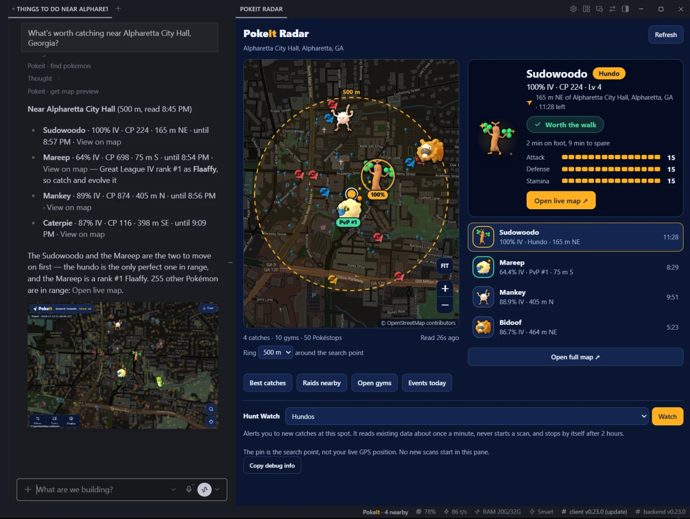

<p align="center">
  <picture>
    <source media="(prefers-color-scheme: dark)" srcset="assets/pokeit-lockup.svg">
    
  </picture>
</p>

**Ask Hermes what's worth catching near you.** A live radar opens beside the chat with the best Pokémon GO catches, raids and events around any spot, from a real scanning network. Set a watch, go back to work, and your desktop tells you when something good appears. No account, no API key.



*Hermes Desktop: the answer in chat, and the PokeIt Radar following it with the featured catch, a live map with gyms, raids and Pokéstops, and real-time desktop alerts. Live data near the Georgia Aquarium in Atlanta.*

## Install

Needs Hermes Agent 0.23.0 or newer (`hermes --version`; update with `hermes update`).

```sh
hermes plugins install kbtbc/pokeit-hermes
```

On Hermes Desktop (0.23.0+) you can use **Capabilities → Plugins → Install from Git** with `https://github.com/kbtbc/pokeit-hermes` instead.

**Then restart Hermes and open a new chat.** On Desktop, quit the app and start it again. A chat that was open during the install, or a Desktop that was not restarted, does not have the PokeIt tools yet, and the Radar cannot follow it.

**Updating from an older PokeIt?** Hermes keeps background processes running after you quit the app, and they hold on to the old version. After `hermes plugins update pokeit` (or a remove and install), restart your computer, or the machine your Hermes backend runs on, before you open Hermes again. If the Radar says Hermes is still running an older PokeIt, that is the fix. Keep one PokeIt install: a second copy in another profile or under another name fights the first.

Update with `hermes plugins update pokeit`. Installs made with `--ref <sha>` stay pinned; move them with `--force --ref <new sha>`.

*Optional:* install into a separate profile to avoid conflicts with other Pokémon GO skills or APIs in your main one: `hermes profile create pokeit`, `hermes -p pokeit setup` (model and keys), then `hermes -p pokeit plugins install kbtbc/pokeit-hermes`, and chat in that profile.

## Try it

Just ask:

> What Pokémon are worth catching near me?

Hermes asks where you are. Name a landmark, an address or an intersection ("Centennial Olympic Park in Atlanta") and the answer comes back with IVs, distances and how long each catch has left. On Hermes Desktop the PokeIt Radar opens beside it by itself.

More to try:

> What's worth catching near the Georgia Aquarium in Atlanta?
>
> What raids and eggs are near the Gateway Arch in St. Louis right now?
>
> Any hundos or rank-one PvP catches near the Georgia Aquarium in Atlanta?

Your agent doesn't know your GPS, so if you only name a city it will ask for something smaller. Answers link to the [live map](https://pokeit.cc/map). You can also try the search without Hermes at [pokeit.cc](https://pokeit.cc).

## How it works

Hermes calls the hosted PokeIt MCP server, which answers from observations on the public map. There is no language model inside the server.

Outside the scanned areas, your agent can ask PokeIt to scan: 49 points covering a 371 m radius. Hermes asks you to approve before it starts, and a scan can take a few minutes. Reading data never starts a scan. Without signing in you get 20 full scans per network per rolling 24 hours, one minute apart.

## Why a plugin, not just a skill

- **It acts, with your approval.** When the map has no data, the agent can ask PokeIt to scan the area. That is a write-capable tool, so Hermes asks before it runs. Nothing else in the plugin can start one.
- **It brings a live service.** Answers come from a scanning network behind `mcp.pokeit.cc`, not from the model's memory or a web search.
- **It has a Desktop half.** A radar pane that follows the chat, catch cards with art and a walking guide, and real-time desktop alerts, built on the Desktop SDK and a small read-only proxy.
- **It works without Desktop.** On the CLI and in chat apps you get the same tools and answers, with plain map links.

## Hermes Desktop

The **PokeIt Radar** opens beside the chat by itself and follows the conversation: ask about catches, raids, gyms, showcases or Pokéstops anywhere and it moves there. It lists the best three or four catches (hundos, nundos and PvP #1 first, then the highest IV) and shows them on a live map with the gyms, raids and Pokéstops around. Click a catch for its IVs, a countdown and whether the walk is worth it. A link under the map opens the same area on the full [live map](https://pokeit.cc/map). There is no search box: ask in chat, or start from the big question on the Radar's first screen. Close the Radar and it stays closed until you open **PokeIt Radar** from the status bar. The buttons under the map (**Best catches**, **Raids nearby**, **Open gyms**, **Events today**) put a ready question in the chat bar, replacing the question the last button wrote and leaving anything you typed. Ask for "PokeIt cards" to get catch cards in the chat. Catch cards show the species art, IVs, a compass to the catch, a live countdown and a walking guide, a straight line at 5 km/h from the place you searched rather than from you. While a scan runs, the Radar moves to the spot and shows a turning sweep, then fills in the catches when it finishes. New scans still use the agent's approval prompt.

The Desktop installer adds the interface locally and the backend to your selected gateway profile. The radar runs on your computer; its small read proxy runs with the gateway. The same package still works without Desktop on CLI and messaging clients.

**Watch it: real-time desktop notifications.** Set it and get on with your work. Pick what you care about (highlights, hundos, nundos, PvP rank #1, or an IV minimum) and press **Watch** on the spot the Radar follows. It checks within 500 m about once a minute and your desktop tells you when a new match appears. It ends by itself after 2 hours, or when you choose **Stop**, switch profile or connection, or the gateway reconnects. It never starts scans, so it needs an area PokeIt scans all the time; where there are no ongoing scans yet, the Radar says so. An alert is a toast titled `PokeIt! Nearby <species> (<IV>%)` that says where it was found and how long is left. Clicking it opens the catch in the Radar. Matches also appear in the app. OS toasts appear when Hermes is in the background and notifications are allowed; whether they play a sound follows your system's notification settings.

## Tools

| Tool | What it does |
|---|---|
| `find_pokemon` | Hundos, nundos and PvP rank 1 by default, or any species, IV or league filter |
| `find_raids` `find_gyms` `find_showcases` `find_max_battles` `find_pokestops` | What is active near a point: raids and eggs, gym slots, showcases, Max Battles, lures and Rocket stops |
| `get_game_context` `get_event_details` | Official event articles that matter for what is nearby |
| `resolve_location` `prepare_search` | The shared decisions every PokeIt surface uses: is this one precise place, and is there data to read, a scan to offer or a limit to explain. Read-only |
| `get_coverage` `request_scan` `get_scan_status` | Check coverage, start an approved scan, follow its progress |
| `search_places` `describe_location` `list_areas` | Place name to coordinates and back (worldwide), and the listed map areas |
| `get_map_preview` | A map screenshot with a live link |

## What leaves your machine

- Each tool call sends coordinates, place text and filters to `https://mcp.pokeit.cc`, which PokeIt runs. No files, credentials or conversation text are sent. Desktop uses the same host through a read-only Python proxy in your Hermes gateway, with a short in-memory cache, and the proxy also loads species icons from `https://pokeit.cc/assets`; no location goes with an icon request. Opening a map link opens `https://pokeit.cc` in your browser.
- The service keeps tool names, filters, timings and result counts for about 14 days. A scan request keeps its coordinates and request ID for 24 hours, plus a keyed hash of your network address (not the address) to apply the trial limit. Ordinary web logs hold IP, path, time and status.
- This preview build sends the header `X-PokeIt-Search-Diagnostics: 1`, so the service also logs the place text you submit for about 14 days, to debug searches. Coordinates, full tool payloads and conversations are not part of that log. To opt out, remove the header in your own MCP config, or send `Sec-GPC: 1`.
- Place search uses OpenStreetMap data, © [OpenStreetMap contributors](https://www.openstreetmap.org/copyright) (ODbL). Species names in other languages can come from WatWowMap's public translation files on GitHub; no user data goes with that request.
- Map previews are drawn by the service in a signed-out browser and cached for 60 seconds.
- The Radar saves your last spot and radius, and the watch saves its filter and minimum IV, locally per gateway/profile. A running watch keeps its location and seen catches in memory and does not resume after reopening the app.
- The server runs separately from this repository and can change after you install. Results are not exhaustive and observations can expire before you arrive.

## If the tools disappear

In Hermes CLI, run `/reload-mcp`. On Desktop, close and reopen the app, select the profile where PokeIt is enabled, and start a fresh chat. Desktop doesn't expose that slash command; reopening the app reconnects it without restarting your remote gateway.

## Other clients

Any MCP client can connect to `https://mcp.pokeit.cc/mcp` over Streamable HTTP. The skill in this repository is Hermes guidance.

## Package

`plugin.json`, `mcp.json`, one skill, `desktop/plugin.js` and a small `dashboard/` proxy. No extra dependencies or build step. No `plugin.yaml`: with one present, Hermes skips the portable MCP tools.

---

Questions and feedback: [Discord](https://discord.gg/3NSTeCxBXk). MIT licensed.

PokeIt is not affiliated with or endorsed by Nintendo, Niantic, Scopely, The Pokémon Company, Creatures or GAMEFREAK. Pokémon and Pokémon GO are trademarks of their owners.
