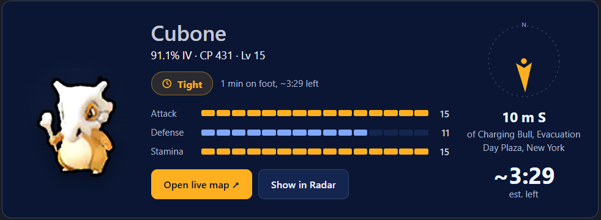

<p align="center">
  <picture>
    <source media="(prefers-color-scheme: dark)" srcset="assets/pokeit-lockup.svg">
    
  </picture>
</p>

**Live Pokémon GO data for your Hermes agent.** Hundos, raids, showcases and events near any spot, from a real scanning network. No account, no API key.



*A catch card in Hermes Desktop, from a real scan at the Charging Bull in New York.*

## Try it

```sh
hermes plugins install kbtbc/pokeit-hermes
```

To update later: `hermes plugins update pokeit`. (Installs made with `--ref <sha>` stay pinned; move them with `--force --ref <new sha>`.)

Then ask:

> Any hundos or rank-one PvP catches near Alpharetta City Hall?
>
> What raids and showcases are on near Alpharetta City Hall?
>
> What's worth catching near Alpharetta City Hall? (On Hermes Desktop, add "Show PokeIt cards".)

Give a specific spot: an address, an intersection or a landmark. Your agent doesn't know your GPS, so if you only name a city it will ask for something smaller. Answers link to the [live map](https://pokeit.cc/map). You can also try the search without Hermes at [pokeit.cc](https://pokeit.cc).

## How it works

Hermes calls the hosted PokeIt MCP server, which answers from observations on the public map. There is no language model inside the server.

Outside the mapped areas, your agent can ask PokeIt to scan: 49 points covering a 371 m radius. Hermes asks you to approve before it starts, and a scan can take a few minutes. Reading data never starts a scan. Without signing in you get 20 full scans per network per rolling 24 hours, one minute apart.

## Hermes Desktop

On Hermes 0.23.0 or newer, use **Capabilities → Plugins → Install from Git** with `https://github.com/kbtbc/pokeit-hermes`. Then open **PokeIt Radar** from the status bar. Pick a spot to see its catches on a radar and in a list, or use **Show in Radar** on a chat card. Ask for "PokeIt cards", or press **Best catches** in the Radar, to get catch cards in the chat. Catch cards show the species art, IVs, a compass to the catch, a live countdown and a walking guide, a straight line at 5 km/h from the place you searched rather than from you. Scan cards fill a progress ring as points are confirmed. New scans still use the agent's approval prompt.

The Desktop installer adds the interface locally and the backend to your selected gateway profile. The radar runs on your computer; its small read proxy runs with the gateway. The same package still works without Desktop on CLI and messaging clients.

**Hunt Watch:** pick a Radar spot and a catch filter, then choose **Watch this spot**. It checks existing observations within 500 m about once a minute and alerts you to new matches. Choose **Stop watch** to finish; switching profile or connection also stops it. It never starts scans. Matches appear in the app, with OS notifications when Hermes is in the background and notifications are allowed.

## Tools

| Tool | What it does |
|---|---|
| `find_pokemon` | Hundos, nundos and PvP rank 1 by default, or any species, IV or league filter |
| `find_raids` `find_gyms` `find_showcases` `find_max_battles` `find_pokestops` | What is active near a point: raids and eggs, gym slots, showcases, Max Battles, lures and Rocket stops |
| `get_game_context` `get_event_details` | Official event articles that matter for what is nearby |
| `get_coverage` `request_scan` `get_scan_status` | Check coverage, start an approved scan, follow its progress |
| `search_places` `describe_location` `list_areas` | Place name to coordinates and back (worldwide; clear matches proceed, ambiguous places need clarification), and the listed map areas |
| `get_map_preview` | A map screenshot with a live link |

## What leaves your machine

- Each tool call sends coordinates, place text and filters to `https://mcp.pokeit.cc`, which PokeIt runs. No files, credentials or conversation text are sent. Desktop uses the same host through a read-only Python proxy in your Hermes gateway, with a short in-memory cache, and the proxy also loads species icons from `https://pokeit.cc/assets`; no location goes with an icon request. Opening a map link opens `https://pokeit.cc` in your browser.
- The service keeps tool names, filters, timings and result counts for about 14 days. A scan request keeps its coordinates and request ID for 24 hours, plus a keyed hash of your network address (not the address) to apply the trial limit. Ordinary web logs hold IP, path, time and status.
- This preview build sends the header `X-PokeIt-Search-Diagnostics: 1`, so the service also logs the place text you submit for about 14 days, to debug searches. Coordinates, full tool payloads and conversations are not part of that log. To opt out, remove the header in your own MCP config, or send `Sec-GPC: 1`.
- Place search uses OpenStreetMap data, © [OpenStreetMap contributors](https://www.openstreetmap.org/copyright) (ODbL). Species names in other languages can come from WatWowMap's public translation files on GitHub; no user data goes with that request.
- Map previews are drawn by the service in a signed-out browser and cached for 60 seconds.
- The Radar saves your last spot and radius, and Hunt Watch saves its filter and minimum IV, locally per gateway/profile. The saved spot is only read when you choose **Resume**. A running watch keeps its location and seen catches in memory and does not resume after reopening the app.
- The server runs separately from this repository and can change after you install. Results are not exhaustive and observations can expire before you arrive.

## If the tools disappear

In Hermes CLI, run `/reload-mcp`. On Desktop, close and reopen the app, select the profile where PokeIt is enabled, and start a fresh chat. Desktop doesn't expose that slash command; reopening the app reconnects it without restarting your remote gateway.

## Other clients

Any MCP client can connect to `https://mcp.pokeit.cc/mcp` over Streamable HTTP. The skill in this repository is Hermes guidance.

## Package

`plugin.json`, `mcp.json`, one skill, `desktop/plugin.js` and a small `dashboard/` proxy. No extra dependencies or build step. No `plugin.yaml`: with one present, Hermes skips the portable MCP tools.

---

Questions and feedback: [Discord](https://discord.gg/3NSTeCxBXk). MIT licensed.

PokeIt is not affiliated with or endorsed by Nintendo, Niantic, Scopely, The Pokémon Company, Creatures or GAMEFREAK. Pokémon and Pokémon GO are trademarks of their owners.
